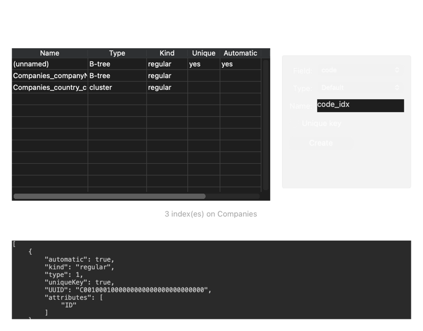

# HDI_ManageIndexes

Manage 4D indexes programmatically: enumerate them with
`DataClass.getIndexes()` (new in 4D 21 R5), create them with
`CREATE INDEX` and remove them with `DELETE INDEX` -- all at runtime,
against a dataclass chosen in the UI.

The demo opens on the standard HDI splash, then chains to an index
manager form: pick a table, see every index reported by `getIndexes()`
as a list and as raw JSON, create a new index from a field, an index
type and a name, and delete an existing one.



## What it demonstrates

- `DataClass.getIndexes()` on three dataclasses (`Companies`, `Persons`,
  `Documents`), returning each index's `name`, `type`, `kind`,
  `uniqueKey`, `automatic`, `UUID` and `attributes`.
- Index kinds the catalog defines: B-tree, cluster B-tree, keywords,
  a unique index, a composite index and a vector index (cosine).
- `CREATE INDEX` with the type sentinels `-1` (keywords), `1` (B-tree),
  `3` (cluster) and `4`/`5`/`6` (vector cosine/dot/euclidean).
- `DELETE INDEX` both by index name and by field pointer.
- Classic structure access (`Last table number`, `Table name`,
  `Last field number`, `Field name`, `Field`) to resolve the table and
  field the user picks at runtime.
- Verification after every operation by calling `getIndexes()` again.

## Key commands

| Command / API | Used for |
|---|---|
| [`DataClass.getIndexes()`](https://developer.4d.com/docs/API/DataClassClass#getindexes) | list the indexes of a dataclass |
| [`CREATE INDEX`](https://developer.4d.com/docs/commands/create-index) | create an index at runtime |
| [`DELETE INDEX`](https://developer.4d.com/docs/commands/delete-index) | delete by name or by field pointer |
| [`Table name`](https://developer.4d.com/docs/commands/table-name) / [`Last table number`](https://developer.4d.com/docs/commands/last-table-number) | enumerate tables |
| [`Field name`](https://developer.4d.com/docs/commands/field-name) / [`Last field number`](https://developer.4d.com/docs/commands/last-field-number) | enumerate fields |
| [`Field`](https://developer.4d.com/docs/commands/field) | field pointer from table and field numbers |
| [`EXECUTE FORMULA`](https://developer.4d.com/docs/commands/execute-formula) | dynamic `CREATE INDEX` (see points of interest) |

## Requirements

- 4D 21 R5 or above (`getIndexes()` is new in 21 R5; the splash checks
  `Application version` against `2150`).
- No network access and no license feature beyond 4D itself.

## Getting started

Clone the repository and open `Project/HDI_ManageIndexes.4DProject` in
4D 21 R5. On first launch the start method generates fictitious demo
data (12 companies, 120 persons, 20 documents; the vector index exists
in the structure whether or not embeddings are filled). No `Data/`
folder is shipped.

## Running the demo

1. The splash shows the demo title, the required version and the blog
   post. Press **Demo**.
2. The index manager lists every index of the selected table: name,
   type, kind, whether it enforces uniqueness, whether it is automatic,
   and the indexed field(s). The raw `getIndexes()` JSON is shown beside
   the list.
3. Switch tables with the **Table** dropdown; the list and JSON update.
4. To create an index: pick a field, an index type, optionally edit the
   suggested name, set **Unique key** if wanted, and press **Create**.
   The list and JSON refresh immediately.
5. To delete an index: select a row and press **Delete index**. Named
   indexes are deleted by name; unnamed ones (primary key, keywords) by
   field pointer.

## How it works

- `00_Start` runs the HDI startup pattern (worker 1, window reuse) and
  opens the splash with an options object; `BtnDemo` chains to `HDI2`.
- `HDI2` is a formClass form driven by `cs.IndexManager`
  (`Project/Sources/Classes/IndexManager.4dm`): `onLoad` fills the
  table and type dropdowns, `refresh()` calls `getIndexes()` and feeds
  both the list box and the JSON panel, `createIndex()` and
  `deleteIndex()` perform the round trip.
- `test_indexes.4dm` is a headless self-test: it dumps `getIndexes()`
  for every table, then creates and deletes an index by name and by
  field pointer, writing a JSON report. Run it with:

  ```sh
  tool4d --project Project/HDI_ManageIndexes.4DProject \
    --startup-method test_indexes --skip-onstartup \
    --data Project/Data/HDI_ManageIndexes.4DD --create-data \
    --user-param report.json
  ```

  A relative output path resolves against the database folder (the repository root).

- `test_ui.4dm` verifies the demo form wiring headlessly: it loads
  `HDI2` with `FORM LOAD`, drives the same functions the widgets call
  (drop-down selection, `refresh()`, `createIndex()`, row selection via
  `Form.currentIndex`, `deleteIndex()`) and asserts on `Form` state and
  the live catalog. Run it with the same flags and
  `--startup-method test_ui`; the report is `test_ui_report.json`.

  The create step targets `Companies.code`, the one field that carries
  no index: `CREATE INDEX` silently ignores a field that already has an
  equivalent index, so the demo keeps one unindexed field to build on.

## Points of interest

- **`getIndexes()` output shape.** Every index object carries `UUID`,
  `attributes` (a collection of field names), `automatic`, `kind`
  (`regular` or `keywords`), `type` and `uniqueKey`. Unnamed indexes --
  the primary key and keyword indexes -- have **no `name` property at
  all**, not an empty one.
- **Type codes differ between the catalog and `getIndexes()`.** A
  keywords index is type `7` in the catalog but reports `-1` with
  `kind: "keywords"`; a vector index built for cosine similarity is
  type `20` in the catalog but reports `4`, the `CREATE INDEX` sentinel
  for cosine. `typeLabel()` maps the reported codes back to text.
- **Keywords indexes report `automatic: true`** even when defined
  explicitly in the catalog; primary keys do too.
- **`CREATE INDEX` needs a syntactic table reference.** Its `aTable`
  parameter is typed `Table`, and at runtime it rejects `Table($num)`
  and pointer variables with error 59 ("4D was expecting a table") --
  unlike commands such as `GET TABLE PROPERTIES`, whose parameter is
  typed `Pointer` and accepts them. Because the demo resolves the table
  at runtime, `createIndex()` builds the call as a single-statement
  formula over an interprocess pointer array and runs it with
  `EXECUTE FORMULA`.
- **`EXECUTE FORMULA` runs one statement per call.** A multi-statement
  formula (separated with `Char(Carriage return)` or line feeds) fails
  with a syntax error even though each statement works on its own;
  the pointer array is therefore built in the caller and shared through
  `<>idxFields`.
- **`Field(tableNum; fieldNum)`** resolves a field pointer from
  numbers; `Field(fieldPtr)` is the reverse lookup.

## References

- Blog post: [Managing 4D indexes programmatically with getIndexes()](https://blog.4d.com/managing-4d-indexes-programmatically-with-getindexes/)
- Documentation: [DataClass.getIndexes()](https://developer.4d.com/docs/API/DataClassClass#getindexes)
- More HDI examples: [miyako/4d-hdi](https://github.com/miyako/4d-hdi)

## Screenshots


